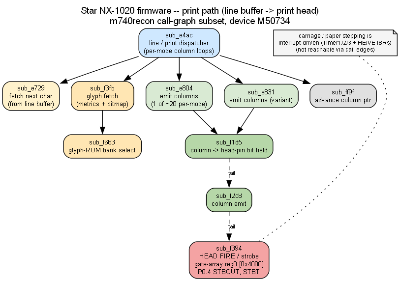

# m740recon

## Overview

m740recon is an advanced disassembler and static analyzer for Renesas/Mitsubishi 740 firmware. Beyond producing as740-compatible assembly, it performs recursive-traversal code/data separation, data-flow value-tracking, declarative control-file driven analysis, cross-referencing, and call-graph / JSON reporting to accelerate reverse-engineering of 8-bit Mitsubishi microcontroller ROMs.

It is also hardware-aware. Tell it what is wired to the chip's pins, what RAM flag bits mean, and where external registers live, and it annotates every instruction that touches them, reports each signal's uses, and checks your description against what the firmware actually does. With no description at all, it reports which port bits the firmware uses and drafts one for you.

m740recon disassembles firmware for many 8-bit Mitsubishi microcontrollers and generates output compatible with the [as740](http://shop-pdp.net/ashtml/as740.htm) assembler. The 16- and 32-bit Mitsubishi microcontrollers use different instruction sets and are not supported.

The underlying disassembler lineage was developed to disassemble the firmware of the [Volkswagen Gamma V](https://github.com/mnaberez/vwradio) and [Volkswagen Rhapsody](https://github.com/mnaberez/vwradio) car radios made by TechniSat. Both radios use the [M38869FFAHP](http://6502.org/documents/datasheets/mitsubishi/renesas_3886_group_users_manual.pdf) microcontroller.

## Quick start

<p align="center"></p>

**Step 1 (optional): bring a helper.**  Point Claude Code or another AI coding agent at this repository and tell it what you have ("disassemble rom.bin, it's an M50734 printer").  [`AGENTS.md`](AGENTS.md) gives it the commands, the working loop and the control-file reference.

**Step 2: run it.**  After [installing](#installation) and activating the environment, give it the ROM and name your chip with `-m`.  Without `-m` it assumes an M3886, which is probably not what you have; the [supported devices](#supported-devices) are listed below.

```
m740recon -m M50734 rom.bin > rom.asm
```

You get a complete listing that reassembles byte-exact: code and data separated, registers and subroutines named, and the port bits each instruction touches (`reads P3.3-7`).  Add `-a` to follow computed jumps.  If that is all you need, you're done.

**Step 3: describe it.**  To get your own names and the meaning of each signal, write a control file.  The firmware drafts the first version for you:

```
echo "device M50734" > fw.m740
m740recon -m M50734 --suggest rom.bin >> fw.m740
```

Then add what you learn, one line per fact:

| You know... | Write | It usually comes from |
|---|---|---|
| which chip it is | [`device`](AGENTS.md#control-file-reference) | the chip marking or datasheet |
| the ROM is not one block at the top of memory | [`segment`](AGENTS.md#control-file-reference) | the board and the datasheet's memory map |
| what a pin is wired to | [`pin`](#declaring-signals) | the schematic, or tracing the board |
| what an SFR bit or RAM flag means | [`bit`](#declaring-signals) | the datasheet, or reading the code |
| where a gate array or other external chip lives | [`pointer`](#external-registers-and-address-spaces) | the schematic and the firmware |
| names for routines, addresses and tables | [`label`, `entry`, `comment`, `range`, `addrtable`](AGENTS.md#control-file-reference) | reading the listing |

[`docs/example.m740`](docs/example.m740) is a complete control file with every directive explained.

**Step 4: run with it.**

```
m740recon -c fw.m740 rom.bin > rom.asm      # listing in your names
m740recon -c fw.m740 --signals rom.bin      # what touches each signal
```

Lint findings on stderr mark every place where your file and the firmware disagree; each one is a question to answer, so fix the file and rerun.  `--routine NAME` and `--signal NAME` show one thing at a time.

**Going further.**  [Reports and visualization](#reports-and-visualization) shows the call graph, one-routine views, the JSON model and call-graph diagrams, with real output.  [Hardware signals](#hardware-signals) covers everything a control file can describe.  [`examples/nx1020/`](examples/nx1020/) is a finished real-world project to copy from.

## Features

 - **Identical reassembly.**  The assembly output of m740recon assembles to a bit-for-bit exact copy of the original binary using as740.  A pure-Python structural round-trip verifies the same property without an external assembler.  Every annotation described below is comment text only, so it never affects reassembly.

 - **Code / data separation.**  Starting from the vectors at the top of memory, m740recon uses recursive-traversal disassembly to separate code from data.

 - **Symbol generation.**  Hardware registers, vectors, referenced memory locations, branch labels, and subroutines are named automatically instead of writing hardcoded addresses.

 - **Declarative control files (`-c`).**  A da65-style control file supplies the device, entry points, labels/comments, a segment memory map, typed data ranges (`byte`/`word`/`addr`/`text`), and address-tables that decode dispatch tables into named handlers - instead of editing source.  Shared parts, such as a board description, can be pulled in with `include`.

 - **Hardware signals.**  `pin`, `bit` and `group` directives name port pins, bit fields, SFR control bits and RAM flags.  Every instruction that provably touches one is annotated with its meaning (`PE: branch if paper present`), including whole-register stores, read-modify-writes, masked reads, direction-register writes, and calls to small routines with fixed effects.  See [Hardware signals](#hardware-signals).

 - **Gate arrays and other external registers.**  Gate arrays such as the NEC D65006 are supported directly.  `pointer` declares a zero-page pointer to fixed hardware, so indirect accesses through it are attributed to the registers they reach, including registers in a second address space the device selects with an enable bit.

 - **Zero-configuration discovery (`--signals`, `--suggest`).**  With no signals declared, m740recon reports which port bits the firmware touches and their direction, and prints `pin` lines to start a board description from.  The listing names the port bits each instruction touches (`and #0x02  reads P0.1`).

 - **Board lint.**  Compares the declarations with the firmware: a pin configured against its declared direction, a signal never used, an output only read, an input written, a port bit used but not declared.

 - **Device hierarchy (`-m`).**  Devices are defined as a base/group/part inheritance hierarchy in `devices.py`, covering the M37450/51, M3802/07/3886, M50734, and many other 740-family parts plus aliases.  Some devices also describe their I/O ports and address spaces for the signal features.  A device can gate opcodes its core does not implement so they decode as data; the hook is in place for cores that need it, though no bundled device currently uses it.

 - **Value-tracking analysis (`-a`, `--auto-tables`).**  Optional constant-propagation resolves computed `jmp [zp]` / `jsr [zp]` targets; `--auto-tables` enumerates contiguous ROM jump tables that feed them.  Both are additive and reassembly-safe.

 - **Cross-references (`-x`).**  Annotates each label with the instructions that reference it.

 - **Reports and queries (`-j`, `-g`, `-s`, `--signal`, `--routine`).**  A machine-readable JSON model, a human-readable call graph, a signal report, or a narrow view of one signal or one routine, instead of the full listing (see [Reports and visualization](#reports-and-visualization)).

 - **AI-friendly.**  m740recon is built to be driven by AI coding agents as well as people: [`AGENTS.md`](AGENTS.md) tells an agent how to use and change it, the JSON output is documented key by key and deterministic, narrow queries answer one question without a whole listing, and every hardware claim carries its confidence.  See [Working with AI agents](#working-with-ai-agents).

## Installation

m740recon is written in Python and requires Python 3.8 or later.  You can download the package from this git repository and then install it into a virtual environment with:

```
$ git clone https://github.com/keithgh1/m740recon.git
$ cd m740recon
$ python3 -m venv ./venv
$ ./venv/bin/pip3 install --editable '.[test]'
```

After running the above, activate the environment so `m740recon` runs by name, as in the examples below:

```
$ source venv/bin/activate        # Windows: venv\Scripts\activate
```

Or run it directly as `./venv/bin/m740recon`, and the unit tests with `./venv/bin/pytest`.

## Usage

m740recon accepts a plain binary file as input.  The file is assumed to be a ROM image that should be aligned to the top of memory.  For example, if a 32K file is given, m740recon will assume the image should be located at 0x8000-0xFFFF.  After loading the image, the disassembler reads the vectors at the top of memory and starts tracing instructions from there.

```
$ ./venv/bin/m740recon input.bin > output.asm
```

The default MCU type is the `M3886` series.  Other types may be specified with the `-m` option, e.g. `-m M37450` or `-m M50734`.  You can add support for new devices by editing `devices.py`.

For anything beyond a single top-aligned ROM - a RAM/ROM split, additional entry points, dispatch tables, data regions, or hardware signals - supply a control file with `-c` instead of editing source.  A control file gives the device, a segment memory map, entry points, labels and comments, typed data ranges, address-tables that decode dispatch tables into named handlers, and the signal directives described below:

```
$ ./venv/bin/m740recon -c firmware.m740 > output.asm        # device + memory map + labels
$ ./venv/bin/m740recon -c firmware.m740 -a -x > output.asm  # + analysis + xrefs
```

The control-file extension `.m740` refers to the 740 chip family.  A complete, annotated control file that exercises every directive - device, a segment memory map, entry points, labels, comments, signals, a pointer, typed data ranges, and an address-table - is included at [`docs/example.m740`](docs/example.m740).  If the control file has `segment` lines, it builds the image itself and no binary argument is given.

Most binaries include some computed jumps.  `-a`/`--analyze` tracks register and zero-page values to resolve `jmp [zp]` / `jsr [zp]` targets, and `--auto-tables` enumerates the ROM jump tables that feed them.  Addresses that still can't be resolved automatically can be named directly in the control file.

Once disassembled, the output file can be re-assembled to an identical binary using [as740](http://shop-pdp.net/ashtml/as740.htm).  A sample [`Makefile`](m740recon/tests/end_to_end/Makefile) is included that shows the required as740 commands.

### Command-line options

| Option | Effect |
|---|---|
| `-m TYPE`, `--mcutype TYPE` | select the device (default `M3886`); overrides the control file's `device` |
| `-c FILE`, `--control FILE` | read a control file |
| `-a`, `--analyze` | resolve computed jumps by value tracking |
| `--auto-tables` | with analysis, enumerate ROM jump tables feeding computed jumps |
| `-x`, `--xref` | annotate labels with the instructions that reference them |
| `-j`, `--json` | print the JSON model instead of the listing |
| `-g`, `--call-graph` | print the call graph instead of the listing |
| `-s`, `--signals` | print the signal report (or port discovery when no signals are declared) |
| `--suggest` | print `pin` lines for touched port bits not yet declared |
| `--signal NAME` | print one signal's report section |
| `--routine R` | print one routine's code (a routine name or a hex address such as `0x8130`) |
| `--no-annotate` | leave signal comments out of the listing |
| `-h`, `--help` | show the usage text |

## Hardware signals

### Declaring signals

A control file can say what is wired to the chip.  `pin` names a port bit or a range of bits, `bit` names any other bit (an SFR control bit, a RAM flag, or a bit of an external register), and `group` collects related signals for the reports.  A board description shared by several firmware revisions can live in its own file and be pulled in with `include`:

```
include board.m740

pin P0.6 PE     in  high="paper end" low="paper present" source=firmware
pin P1.0 EE_CS  out active=high "EEPROM chip select"
pin P2.0-3 PHASE out "stepper phases"
bit 0x52.7 asf_installed "ASF fitted"
group eeprom EE_CS EE_SK EE_DI EE_DO
```

- A location is `ADDR.BIT` or `ADDR.LO-HI`, where `ADDR` is a number, a device register name (`P0`, `ICON1`) or a `label`.
- `in` / `out` / `bidir` give a pin's direction.  `high=` and `low=` say what each level means, and `active=` says which level is "on".
- `source=schematic|firmware|datasheet|guess` records where a fact came from; a guessed signal prints as `NAME?`.
- `bit` also takes `space=NAME` (see [External registers](#external-registers-and-address-spaces)) and `access=read` or `access=write`, so one register bit can carry a meaning when read and a different one when written.
- A text containing spaces or an `=` sign must be quoted; a quoted token is always a description, never an option.

Signal names are comment-only.  They never become assembler symbols, so an annotated listing still reassembles byte-exact.  With no signals declared, the listing still names the port bits each instruction touches (`reads P3.3-7`, `P0.7 = 1`).  `--no-annotate` turns annotation off and gives exactly the listing m740recon produced before signal support.

### What gets annotated

Every instruction that provably touches a declared signal gets a trailing comment.  These lines are from the Star NX-1020 printer firmware:

```
    bbc 6,P0,lab_848e       ;8485  d7 f6 06  PE: branch if paper present
    bbs 7,mem_0052,lab_7307 ;72f7  e7 52 0d  asf_installed: branch if set
    sta P2                  ;8160  85 f0     P2L_PHASE = 0; P2H_PHASE = 9
    sta P2                  ;5030  85 f0     P2H_PHASE = 0
    and #0xf8               ;ff98  29 f8     reads BTN_FONT, BTN_PITCH, BTN_SET, BTN_PF, BTN_OL
    sta P0DIR               ;8150  85 f7     outputs BUSY_PIN, HEAD_STB, DME;
                                        ;  inputs RELEASE_SW, IN_PRIME, TRACTOR_SW, PE, HP
    jsr \sub_ff6e           ;7724  22 6e     -> EE_CS = 1 (asserted)
```

In order, these are:

- **Bit instructions:** `seb`, `clb`, `bbs` and `bbc` on a declared bit.
- **Whole-register stores** of a known value (`lda #0x90` / `sta P2`).
- **Read-modify-writes** (`lda P2` / `and #0x0f` / `sta P2` clears the upper phase field).
- **Masked reads** (`lda P3` ... `and #0xf8` reads the five button bits).
- **Direction and function register writes** in pin terms, on devices that describe their ports (M50734, M3886).
- **Calls to small leaf routines** whose effect is fixed: the routine's effect is shown at each call.

A load followed by `bbs N,a` is reported as a test of that bit.  Instructions with an indexed operand count when the index register's value is known, and reads of a port's input latch count as reads of its pins.  Long annotations continue on comment-only lines, so every listing line stays within the assembler's input buffer.

### External registers and address spaces

Gate arrays are supported directly.  740-family MCUs are commonly paired with a custom gate array, such as the NEC D65006 in the Star NX-1020, that adds what the chip lacks: more I/O, a latched host interface, lamp and print-head drivers, and memory banking.  m740recon treats its registers like any other hardware: declare the pointer the firmware reaches them through and what each bit means, and every access is annotated, reported and checked like a port pin.  The support is generic, so any gate array or external chip reached this way works the same.

Hardware outside the chip is often reached through a zero-page pointer.  `pointer` declares one:

```
pointer 0xae 0x4000 space=dme "gate array base"
bit 0x4003.1 LAMP_ONLINE space=dme access=write "ON LINE lamp"
bit 0x4003.2 LAMP_QUIET  space=dme access=write "QUIET lamp"
```

Each `lda/sta [0xae],y` is then tagged with where it goes:

```
    sta [mem_00ae],y        ;c74e  91 ae     [dme:0x4003] LAMP_QUIET = 1
    sta [mem_00ae],y        ;d9d0  91 ae     [dme:0x4003?] LAMP_ONLINE = 1
    lda [mem_00ae],y        ;ff44  b1 ae     [dme:0x4002|0x4003 Y=2,3] reads
    sta [mem_00ae],y        ;65ee  91 ae     [0x4000, dme off: program space] writes
```

`space=` places the pointer and its registers in a second address space that only pointers reach; direct and absolute operands always address the program space.  When the device describes the space (the M50734 describes its DME data space: enabled by P0FUNC bit 5, reached only by `(zp),Y`), each access through the pointer is checked against the enable bit:

- **Provably on:** the access is attributed to the space.
- **Provably off:** the access goes to the program space, as in the last line above.
- **Unknown:** the access is attributed to the space and marked `?`.

When a shared routine is entered with different Y values, as at `0xff44`, the tag lists every register it can reach.

### Reports, discovery and lint

- `-s` / `--signals` prints every declared signal with each access (routine, address, kind and annotation), the routines that can reach a write to it, any pointer summaries, leaf routines with suggested names (never applied), and the lint findings.  `--signal NAME` prints one signal's section:

```
EE_CS (P1.0)  out, active high   [source: schematic]  EEPROM chip select
  reset     0x8154  write      EE_CS = 0 (not asserted)
  reset     0x8158  direction  EE_CS: output
  sub_ff6e  0xff6e  set        EE_CS = 1 (asserted)
  sub_ff71  0xff71  clear      EE_CS = 0 (not asserted)
```

- With no signals declared, `--signals` reports which port bits the firmware touches and their direction instead.  The direction comes from the firmware's own direction-register writes where it makes them, and is otherwise inferred from use and marked `?`.  Writing a whole port register does not count as using a pin that is an input, the same rule the analysis applies to a declared input, so every suggested pin is one the lint will find used.  `--suggest` turns the same bits into `pin` lines to paste in and rename, skipping any already declared:

```
P0.6   in     36 test, 3 read, 1 write     sub_4cd1, sub_4e69, sub_6b95, reset, sub_8404, ctl_FF, +13 more
P1.0   out    1 set, 1 clear, 1 write      reset, sub_ff6e, sub_ff71

pin P0.6   P0_6   in    source=guess   # 36 test, 3 read, 1 write
```

- Lint findings are printed to stderr whenever signals are declared, and appear in the `--signals` report and the JSON:

```
m740recon: lint: EE_ORG (P1.3): never read or written by the firmware
```

A finding is a disagreement between the declarations and the firmware, not necessarily an error in either.  This one is a pin wired to the EEPROM's unused ORG input; a direction finding such as `declared out, but the firmware makes it an input at 0x...` can equally mean a pin the firmware deliberately switches at run time.

A quick start for a new board:

```
$ ./venv/bin/m740recon -m M50734 --suggest firmware.bin > board.m740
$ ./venv/bin/m740recon -m M50734 -c board.m740 --signals firmware.bin
```

Options must come before the binary's file name.

### What the analysis assumes

The signal analysis reports only what it can prove.  When a value is unknown it says so (`writes EE_CS (value unknown)`, `Y unknown`) or says nothing.  It works on straight-line code: what it knows is reset at each branch target and after each call.  The exception is the index register Y and the T flag at a branch target whose predecessors are all known; there it carries the values all of them agree on.

Specific rules:

- **Read-modify-write:** recognized only where a register reads back what was written.  A bit declared with separate read and write meanings is reported as a separate read and write, and an instruction that reads and rewrites such a register (`seb`, `clb`, `inc`, `com` and the like) is reported as reading its `access=read` signals too.
- **Writes to input pins:** a whole-register write does not assign meaning to input pins, since writing an input's latch has no effect outside the chip.  A read-modify-write that changes an input's bit is reported.
- **The T flag:** assumed clear on entry to a routine, and called routines are assumed to return with it unchanged.  The analysis follows `set`, `clt` and paired `php`/`plp`; while T is set or unknown it records only facts that hold either way, and keeps X and Y known across instructions that do not change them, so every operation redirected to M(X) is attributed.  Only when T is known to be set do operations redirected to M(X) report that access: a read for `cmp`, a write for `lda`, both for `and`, `ora` and the like.
- **Leaf summaries:** only routines of at most eight instructions with no calls, no jumps out and no loops other than counted delay loops, so every effect runs exactly once.
- **Masks:** a load followed by `and #mask` reads only the signals inside the mask; signals the mask clears are not reported as read.
- **Not followed:** values do not flow across calls, and the "reached from" lists follow static calls only, so they are a lower bound when the firmware has computed calls.

## Reports and visualization

In addition to the assembly listing, m740recon can emit reports derived from the traced program.  All of them read only already-traced state and print to stdout in place of the listing:

```
$ ./venv/bin/m740recon -c firmware.m740 --call-graph > callgraph.txt   # human-readable
$ ./venv/bin/m740recon -c firmware.m740 --json       > report.json     # machine-readable
$ ./venv/bin/m740recon -c firmware.m740 --signals    > signals.txt     # hardware signals
$ ./venv/bin/m740recon -c firmware.m740 --routine main_loop            # one routine
```

None of them needs a control file: `m740recon -m M50734 -g rom.bin` works on a bare ROM.  With a control file the reports use your names and include the signals.

`--call-graph` lists each routine with the routines it calls and the routines that call it, and, when signals are declared, the signals it touches.  `--json` writes a structured model (`m740recon-report/1`): routines (each with its outgoing/incoming call edges), vectors, symbols, and a full cross-reference map, plus signal, group, pointer and lint sections when the control file declares them; [`docs/json_model.md`](docs/json_model.md) describes every key.  `--routine` prints the code reachable from a routine's entry without entering other routines, and names the routines it continues into.

Here is one routine from the NX-1020's call graph, the carriage home seek: the routines it calls (with the call site), the routines that call it, and the signal it touches:

```
home_seek [subroutine]
    -> sub_4595               ; @0xd853
    -> sub_d94b               ; @0xd865
    ...
    -> sub_483f               ; @0xd92f
    -> sub_481d               ; @0xd934
    <- reset, sub_d32c
    signals: HP(test)
```

And `--routine panel_read` prints just the front-panel button reader instead of the whole 50,000-line listing:

```
panel_read:
    lda P3                  ;ff8f  a5 ee
    ldm #0xff,WDT           ;ff91  3c ff fc
    cmp P3                  ;ff94  c5 ee     reads CR_CMN_HV, LF_CMN_HV, BTN_FONT, BTN_PITCH, BTN_SET, BTN_PF, BTN_OL
    bne panel_read          ;ff96  d0 f7
    and #0xf8               ;ff98  29 f8     reads BTN_FONT, BTN_PITCH, BTN_SET, BTN_PF, BTN_OL
    rts                     ;ff9a  60
```

The JSON model renders into a [Graphviz](https://graphviz.org/) diagram.  A full firmware graph is usually too large to read, so filter to a routine of interest - for example, everything reachable from one routine, two levels deep:

```python
# report_to_dot.py: turn `m740recon --json` output into Graphviz
import json, sys
model = json.load(open(sys.argv[1]))
routines = {r["address"]: r for r in model["routines"]}
by_name = {r["name"]: r["address"] for r in model["routines"]}
root = by_name[sys.argv[2]]
depth = int(sys.argv[3]) if len(sys.argv) > 3 else 2

seen, frontier = set(), {root}
for _ in range(depth + 1):
    seen |= frontier
    frontier = {e["to"] for a in frontier if a in routines
                for e in routines[a]["calls"]} - seen

print("digraph g {\n  rankdir=LR;\n  node [shape=box, fontname=Helvetica];")
for a in seen:
    for e in routines.get(a, {}).get("calls", []):
        if e["to"] in seen:
            dash = "" if e["type"] == "call" else " [style=dashed]"
            print('  "%s" -> "%s"%s;' % (routines[a]["name"], e["name"], dash))
print("}")
```

```
$ ./venv/bin/m740recon -c firmware.m740 --json > report.json
$ python report_to_dot.py report.json main_loop 2 | dot -Tsvg -o callgraph.svg
```

For example, here is a call graph rendered from real firmware - the *print path* of a Star NX-1020 dot-matrix printer (an M50734-based device), from the line/print dispatcher down to the routine that fires the print head:



The boxes are subroutines that m740recon traced and named, joined by the call and tail-call edges it recovered; the short descriptions are annotations added by hand to make the path readable.  The Graphviz source for this diagram is included at [`docs/nx1020_printpath.dot`](docs/nx1020_printpath.dot).

A complete worked example, the NX-1020 control file and board description, is in [`examples/nx1020/`](examples/nx1020/); its README shows how to fetch the ROM images.  The NX-1020 reverse engineering that drove these features is published at [star-nx1020-re](https://github.com/keithgh1/star-nx1020-re): the extracted resident fonts, the labeled firmware disassembly (built with an m740recon control file), an interactive ROM map, and full documentation.

## Working with AI agents

Reverse-engineering firmware is a long loop of reading code, forming a hypothesis, writing it down and checking it.  AI coding agents are good at that loop, so m740recon is designed to be driven by them as well as by people.

- **[`AGENTS.md`](AGENTS.md)** is the entry point for an agent.  It gives the commands, a step-by-step working loop for a new firmware, the full control-file reference, the rules any change to the code must keep, how to run the tests, and a map of the modules.  [`CLAUDE.md`](CLAUDE.md) points to it, for tools that look for that name.
- **A documented machine interface.**  `-j` prints a JSON model whose every key is described in [`docs/json_model.md`](docs/json_model.md), with a format tag (`m740recon-report/1`) to check against.  Agents should parse it rather than the text listing or reports, whose layout may change.
- **Deterministic output.**  The same input always produces byte-identical output, so a change in output always means a change in input or in the tool.  The test suite checks this across Python hash seeds.
- **Narrow queries.**  `--routine NAME` and `--signal NAME` answer one question at a time, which fits an agent's limited context far better than a 50,000-line listing.
- **Claims an agent can weigh.**  Every signal access in the JSON says how it was established: `exact` (the instruction names the bit), `derived` (straight-line value tracking), `assumed` (through an address space whose enable bit is not proven), or `path` (one of several locations depending on how the code was reached).  When a value cannot be proven the tool says so instead of guessing, so an agent can tell a fact from an inference.
- **An incremental, checkable workflow.**  `--suggest` drafts a board description from the firmware alone; an agent refines it in the control file as it learns, records where each fact came from with `source=`, and reruns.  The lint on stderr points at every place the description and the firmware disagree, which is where the next question is.
- **Precise errors.**  Every control-file error names the file and line, so an agent can fix its own mistakes without guessing.

## Supported devices

m740recon ships with definitions for 24 740-family parts, selectable by 48 names: the 24 part names plus 24 aliases for sibling part numbers and alternate spellings (some parts have several aliases, many have none).  Choose a device with `-m`, or with the `device` directive in a control file (`-c`); an explicit `-m` takes precedence over the control file.  The default is `M3886`.

```
$ ./venv/bin/m740recon -m M50734 input.bin > output.asm
```

Names are case-sensitive and must match exactly.  Passing an unrecognized name prints the full list of accepted names:

```
$ ./venv/bin/m740recon -m bogus input.bin
Unsupported MCU type requested (bogus)! Currently supported: ...
```

A device definition supplies the interrupt/reset **vector table** and a **symbol table** that names the special-function registers (SFRs), I/O ports, and vectors of that part, so the listing reads in datasheet terms instead of bare addresses.  Devices are organized as a base/group/part inheritance hierarchy in [`m740recon/devices.py`](m740recon/devices.py): a group base (for example the shared core behind `M3802`/`M3807`/`M3886`) defines the common vectors and ports, and each part inherits it and then adds or overrides its own SFRs.  A device may also declare opcodes its core does not implement so they decode as data rather than instructions; the hook exists but no bundled device currently needs it.

Two devices carry extra metadata for the signal features:

| Device | Port metadata | Address spaces |
|---|---|---|
| `50734` (`M50734`) | P0-P4: data, direction, P0 function and P1 input-latch registers | `dme`: enabled by P0FUNC bit 5, reached by `(zp),Y` |
| `M3886` | P0-P7: data and direction registers | - |

With port metadata, writes to direction and function registers are shown in pin terms, discovery uses the real ports and the firmware's own direction settings, and the lint can check declared directions.  Other devices fall back to registers named `P0`, `P1`, ... for discovery and skip those checks.  The M50734 DME rule that only `(zp),Y` reaches the data space rests on the behavior of real firmware, since the datasheet does not name the addressing modes.

Note the mix of naming conventions: a few parts carry an `M` prefix (`M3886`, `M3802`, `M3807`) while most are bare numbers (`50734`, `50740A`, `37410M3`).  The familiar `M3xxxx`/`M5xxxx` spellings (`M37450`, `M37451`, `M50734`) are provided as aliases of the bare-number entries.

### Hand-curated cores

Vectors and SFR names for these cores are hand-verified; a datasheet-sourced reference register map for each is included in [`docs/`](docs) (one file per core).

| Device | Aliases |
|---|---|
| `7450` | `M37450`, `37450S1`, `37450M4`, `37450M8`, `37450S2`, `37450S4` |
| `7451` | `M37451` |
| `M3802` | - |
| `M3807` | - |
| `M3886` | - |
| `50734` | `M50734`, `50734_10` |

### MELPS 740 devices (datasheet-derived)

These entries were generated from the MELPS 740 databook.  Their **vectors and register addresses are datasheet-derived and reliable**, but the SFR symbol *names* are heuristic and may be refined - treat the mnemonics as a starting point.  None overlaps a hand-curated core above.

| Device | Aliases |
|---|---|
| `50740A` | `50741` |
| `50742` | `50708` |
| `50743` | - |
| `50744` | `50746` |
| `50745` | - |
| `50747` | `50747H` |
| `50752` | `50757`, `50758` |
| `50753` | - |
| `50754` | `50954`, `50955` |
| `50930` | `50931`, `50932` |
| `50940` | `50941` |
| `50943` | - |
| `50944` | - |
| `50950` | `50951` |
| `50957` | `50959` |
| `50964` | `50963` |
| `37410M3` | `37410M4` |
| `37415M4` | - |

A few parts place their vectors well below the top of a 64K image - `50740A`/`50752` at `0x1FFE` (an 8K space) and `50930`/`37410M3`/`37415M4` at `0x3FFE` (a 16K space).  These are not top-aligned 64K ROMs, so describe their layout with a control-file memory map (`-c`) rather than passing a plain top-aligned binary (see [Usage](#usage)).

### Adding a device

To add a part, add a `_define(...)` entry to [`m740recon/devices.py`](m740recon/devices.py) - optionally inheriting an existing base - plus any `_alias(...)` lines for sibling part numbers that share its register map.  No other code changes are required: the new name becomes a valid `-m` value automatically.  To enable the port-aware signal features for it, also pass `ports=` (each port's data, direction, function and input-latch registers) and, if it has a second address space, `spaces=`; the M50734 entry shows both.

## Testing

```
$ ./venv/bin/pytest
```

Every input is a synthetic fixture, the repository's own `testprog.asm`, or the NX-1020 example.  The NX-1020 ROM images are downloaded on first run from [star-nx1020-re](https://github.com/keithgh1/star-nx1020-re) at a pinned commit and checked by SHA-256; without network access those tests skip.  CI sets `M740RECON_REQUIRE_NX1020=1`, which turns that skip into a failure.

`tests/test_realworld_nx1020.py` checks the tool against a real firmware, the Star NX-1020 printer in [`examples/nx1020/`](examples/nx1020/), whose pin map and behavior have been verified independently.  Most of its checks assert documented facts about the firmware.  The rest compare output against goldens in `m740recon/tests/golden/nx1020/`: with signal features off, the output must still match what m740recon produced before signal support existed; with them on, it must match the pinned current output.  After an intended change, regenerate the current goldens with `python -m m740recon.tests.update_nx1020_golden` and review the diff.

The end-to-end reassembly tests use the real [as740](http://shop-pdp.net/ashtml/as740.htm) + aslink to prove the listing assembles bit-for-bit back to the input, including densely annotated listings.  When that toolchain is not found on `PATH` (or as `<tool>.exe` in `~/bin`) those tests **skip** and the rest of the suite still passes - the pure-Python structural round-trip (`test_roundtrip`) keeps re-encoding verified in the meantime.  Set `M740_REQUIRE_AS740=1` to turn a missing toolchain into a hard failure instead (recommended for CI that must never let the reassembly guarantee go unverified).  To run the full check locally, build `as740` and `aslink` from the ASxxxx source and put them on `PATH`.

## Relationship to m740dasm

m740recon is a friendly fork of [m740dasm](https://github.com/mnaberez/m740dasm) by Mike Naberezny, used under its BSD-3-Clause license. m740dasm provides the proven 740-family instruction set, the recursive-traversal disassembler core, automatic symbol generation, and the bit-for-bit-exact reassembly guarantee.

m740recon builds on that foundation with a static-analysis and reverse-engineering focus, adding:

 - declarative da65-style control files (`-c`) for device selection, segment memory maps, entry points, labels/comments, typed data ranges, and address-table decoding;
 - a base/group/part device inheritance hierarchy spanning many 740-family parts and aliases;
 - data-flow value-tracking (`-a`) to resolve computed `jmp [zp]` / `jsr [zp]` targets, with automatic ROM jump-table enumeration (`--auto-tables`);
 - cross-reference annotation (`-x`);
 - hardware-signal annotation, external-register pointers and address spaces, port discovery, and board lint;
 - human-readable call-graph, signal and JSON reports for visualization; and
 - narrow per-routine and per-signal queries for tools and AI agents.

m740recon is an independent project. Mike Naberezny does not endorse, sponsor, or maintain m740recon, and m740dasm is credited only as the basis from which this fork is derived.

## Author

m740recon is maintained by [Keith Monahan](https://github.com/keithgh1).

The original m740dasm disassembler, on which m740recon is based, was created by [Mike Naberezny](https://github.com/mnaberez) ([m740dasm](https://github.com/mnaberez/m740dasm)).

## License

m740recon is distributed under the BSD-3-Clause license. The original copyright notice, conditions, and disclaimer - copyright (c) 2018 Mike Naberezny and contributors - are retained in [LICENSE](LICENSE.txt). Additions made in this fork are copyright (c) 2026 Keith Monahan. See [LICENSE](LICENSE.txt) for the full text.
