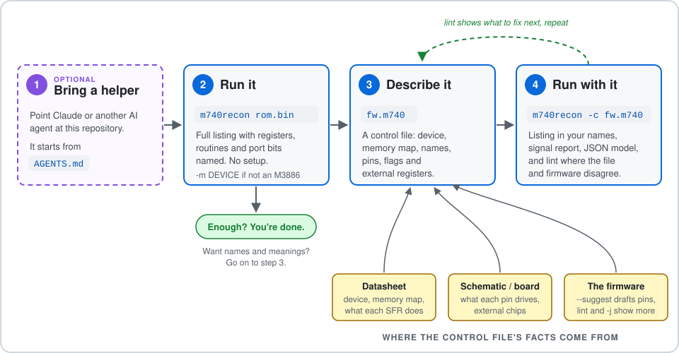

# m740recon

m740recon disassembles firmware for the Mitsubishi/Renesas 740 family of 8-bit microcontrollers into a listing that reassembles byte-exact with [as740](http://shop-pdp.net/ashtml/as740.htm).  Give it a ROM and it works out the chip, the load address and the dispatch tables itself.  Describe the board in a control file and it also says what each instruction does to the hardware.

The 16- and 32-bit Mitsubishi families use other instruction sets and are not supported.

## Quick start

<p align="center"></p>

After [installing](#installation), there are three levels.  Most people only need the first.

**1. Just run it.**

```
m740recon rom.bin > rom.asm
```

The top of the listing says what was detected and how sure m740recon is:

```
; base    0x8000   detected (high): 916 call targets line up after routine ends (next best 167)
; device  M50734   detected (high): vectors fit 1.00, SFR match 0.15; runner-up 50944
```

Wrong chip?  Name it: `m740recon -m M50734 rom.bin`.

**2. Let it find more.**

```
m740recon --suggest rom.bin > fw.m740
```

This finds more code and writes a draft control file: device, dispatch tables, extra code, text and a `pin` line per port bit.  Every line ends with how sure m740recon is and why; doubtful lines are commented out.  For only the extra code, add `-A` to a normal run instead.

**3. Make it yours.**

```
m740recon -c fw.m740 rom.bin > rom.asm
```

Edit the draft as you learn (names, what each pin is wired to; see [what goes in a control file](#what-goes-in-a-control-file)) and rerun.  Lint on stderr marks every place where your file and the firmware disagree.

**With an AI agent:** point Claude Code or another AI agent at this repository; [`AGENTS.md`](AGENTS.md) tells it what to do.

## Features

- **Byte-exact reassembly** with as740.  Everything m740recon adds is comment text.
- **Detection** of the chip, load address, banks and dispatch tables, each with a confidence and a reason.  [More](docs/detection.md)
- **`--advanced`** finds more code by evidence and marks every such entry `inferred`.
- **`--suggest`** writes a draft control file from everything it found.
- **Control files** (`-c`) for the device, memory map, entry points, names, data ranges and dispatch tables.  [Reference](AGENTS.md#control-file-reference)
- **Hardware signals**: pins, bits and RAM flags annotated on every instruction that touches them, external registers and gate arrays such as the NEC D65006, plus board lint.  [More](docs/signals.md)
- **Reports**: JSON model, call graph, signal report, one-routine and one-signal views, cross-references (`-x`).  [More](docs/reports.md)
- **Devices**: 48 names across the 740 family.  [List](docs/devices.md)
- **Built for AI agents** as well as people.  [More](docs/ai-agents.md)

## Installation

m740recon is written in Python and requires Python 3.8 or later.  You can download the package from this git repository and then install it into a virtual environment with:

```
$ git clone https://github.com/keithgh1/m740recon.git
$ cd m740recon
$ python3 -m venv ./venv
$ ./venv/bin/pip3 install --editable '.[test]'
```

After running the above, activate the environment so `m740recon` runs by name, as in the examples below:

```
$ source venv/bin/activate        # Windows: venv\Scripts\activate
```

Or run it directly as `./venv/bin/m740recon`, and the unit tests with `./venv/bin/pytest`.

## Usage

```
m740recon rom.bin > rom.asm                  # detect everything
m740recon low.bin high.bin > rom.asm         # two EPROMs, each placed by its code
m740recon -m M50734 rom.bin > rom.asm        # name the chip yourself
m740recon -A rom.bin > rom.asm               # also code found by evidence
m740recon --suggest rom.bin > fw.m740        # draft control file
m740recon -c fw.m740 rom.bin > rom.asm       # with your control file
m740recon -c fw.m740 -j rom.bin > model.json # JSON model instead of a listing
```

If the control file has `segment` lines, it builds the image itself and no binary is given.  The listing reassembles with as740; [`m740recon/tests/end_to_end/Makefile`](m740recon/tests/end_to_end/Makefile) shows the commands.

### What goes in a control file

Add what you learn, one line per fact:

| You know... | Write, for example | It usually comes from |
|---|---|---|
| which chip it is | [`device M50734`](AGENTS.md#control-file-reference) | the chip marking or datasheet |
| where each ROM file sits (banked ROM, or the detected load address is wrong) | [`segment fw 0x8000 0x10000 rom.bin`](AGENTS.md#control-file-reference) | the board and the datasheet's memory map |
| what a pin is wired to | [`pin P1.0 EE_CS out "EEPROM chip select"`](docs/signals.md#declaring-signals) | the schematic, or tracing the board |
| what an SFR bit or RAM flag means | [`bit 0x52.7 asf_installed "ASF fitted"`](docs/signals.md#declaring-signals) | the datasheet, or reading the code |
| where a gate array or other external chip lives | [`pointer 0xae 0x4000 "gate array base"`](docs/signals.md#external-registers-and-address-spaces) | the schematic and the firmware |
| what a routine or variable is | [`label 0x8533 main_loop "dispatch one host byte"`](AGENTS.md#control-file-reference) | reading the listing |
| code the trace missed (reached only by a computed jump) | [`entry 0xab00 keypad_scan`](AGENTS.md#control-file-reference) | reading the listing |
| a note worth keeping at an address | [`comment 0x8533 "unknown commands are ignored"`](AGENTS.md#control-file-reference) | reading the listing |
| what a block of data is | [`range 0xc000 0xc040 text`](AGENTS.md#control-file-reference) | reading the listing |
| where a table of code pointers is | [`addrtable 0xc0d4 stride=3 entryoff=1 terminator=0x00`](AGENTS.md#control-file-reference) | reading the listing |

[`docs/example.m740`](docs/example.m740) is a complete control file with every directive explained.

### Command-line options

| Option | Effect |
|---|---|
| `-m TYPE`, `--mcutype TYPE` | select the device (default: detected); overrides the control file's `device` |
| `-c FILE`, `--control FILE` | read a control file |
| `-A`, `--advanced` | also find code by evidence (pointer tables, code after routine ends), each entry marked `inferred` |
| `-a`, `--analyze` | value tracking; now always on (kept for compatibility) |
| `--auto-tables` | same as `--advanced` |
| `-x`, `--xref` | annotate labels with the instructions that reference them |
| `-j`, `--json` | print the JSON model instead of the listing |
| `-g`, `--call-graph` | print the call graph instead of the listing |
| `-s`, `--signals` | print the signal report (or port discovery when no signals are declared) |
| `--suggest` | print a draft control file (device, memory map, tables, inferred code, pins) with a confidence and reason per line; with `-c`, only what is new |
| `--suggest=pins` | print only `pin` lines for touched port bits not yet declared |
| `--signal NAME` | print one signal's report section |
| `--routine R` | print one routine's code (a routine name or a hex address such as `0x8130`) |
| several binaries | each is placed by its own detected load address; overlapping or unplaceable files stop with `segment` lines to fill in |
| `--no-annotate` | leave signal comments out of the listing |
| `-h`, `--help` | show the usage text |

## Documentation

| Page | What it covers |
|---|---|
| [Detection and inference](docs/detection.md) | what is detected, how, and the confidence words |
| [Hardware signals](docs/signals.md) | `pin`, `bit`, `group`, `pointer`, address spaces, annotations, lint |
| [Reports and visualization](docs/reports.md) | call graph, routine and signal views, JSON, diagrams |
| [JSON model](docs/json_model.md) | every key of the `-j` output |
| [Supported devices](docs/devices.md) | the device list and how to add one |
| [Example control file](docs/example.m740) | every directive, explained |
| [NX-1020 example](examples/nx1020/) | a finished real-world project |
| [Working with AI agents](docs/ai-agents.md) | why and how m740recon suits agents |
| [`AGENTS.md`](AGENTS.md) | commands, working loop, control-file reference, module map |
| [Testing](docs/testing.md) | the test suite, goldens and the as740 check |

## Testing

```
pytest
```

The tests use synthetic fixtures and the NX-1020 example, whose ROMs are downloaded and checked by SHA-256.  Reassembly tests need as740 and aslink on `PATH` and skip without them.  [Details](docs/testing.md)

## Relationship to m740dasm

m740recon is a friendly fork of [m740dasm](https://github.com/mnaberez/m740dasm) by Mike Naberezny, used under its BSD-3-Clause license. m740dasm provides the proven 740-family instruction set, the recursive-traversal disassembler core, automatic symbol generation, and the bit-for-bit-exact reassembly guarantee.

m740recon is an independent project. Mike Naberezny does not endorse, sponsor, or maintain m740recon, and m740dasm is credited only as the basis from which this fork is derived.

## Author

m740recon is maintained by [Keith Monahan](https://github.com/keithgh1).

The original m740dasm disassembler, on which m740recon is based, was created by [Mike Naberezny](https://github.com/mnaberez) ([m740dasm](https://github.com/mnaberez/m740dasm)).

## License

m740recon is distributed under the BSD-3-Clause license. The original copyright notice (copyright (c) 2018 Mike Naberezny and contributors), conditions, and disclaimer are retained in [LICENSE](LICENSE.txt). Additions made in this fork are copyright (c) 2026 Keith Monahan. See [LICENSE](LICENSE.txt) for the full text.
