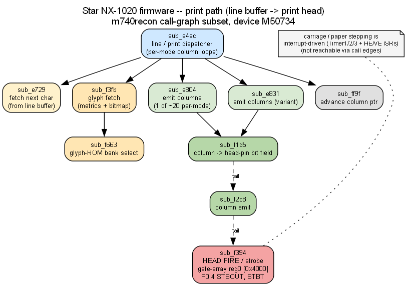

# Reports and visualization

m740recon can also print reports built from the traced program.  Each one goes to stdout in place of the listing:

```
$ ./venv/bin/m740recon -c firmware.m740 --call-graph > callgraph.txt   # human-readable
$ ./venv/bin/m740recon -c firmware.m740 --json       > report.json     # machine-readable
$ ./venv/bin/m740recon -c firmware.m740 --signals    > signals.txt     # hardware signals
$ ./venv/bin/m740recon -c firmware.m740 --routine main_loop            # one routine
```

None of them needs a control file: `m740recon -m M50734 -g rom.bin` works on a bare ROM.  With a control file the reports use your names and include the signals.

`--call-graph` lists each routine with the routines it calls and the routines that call it, and, when signals are declared, the signals it touches.  `--json` writes a structured model (`m740recon-report/1`): routines (each with its outgoing/incoming call edges), vectors, symbols, and a full cross-reference map, plus signal, group, pointer and lint sections when the control file declares them; [`docs/json_model.md`](json_model.md) describes every key.  `--routine` prints the code reachable from a routine's entry without entering other routines, and names the routines it continues into.

Here is one routine from the NX-1020's call graph, the carriage home seek: the routines it calls (with the call site), the routines that call it, and the signal it touches:

```
home_seek [subroutine]
    -> sub_4595               ; @0xd853
    -> sub_d94b               ; @0xd865
    ...
    -> sub_483f               ; @0xd92f
    -> sub_481d               ; @0xd934
    <- reset, sub_d32c
    signals: HP(test)
```

And `--routine panel_read` prints just the front-panel button reader instead of the whole 50,000-line listing:

```
panel_read:
    lda P3                  ;ff8f  a5 ee
    ldm #0xff,WDT           ;ff91  3c ff fc
    cmp P3                  ;ff94  c5 ee     reads CR_CMN_HV, LF_CMN_HV, BTN_FONT, BTN_PITCH, BTN_SET, BTN_PF, BTN_OL
    bne panel_read          ;ff96  d0 f7
    and #0xf8               ;ff98  29 f8     reads BTN_FONT, BTN_PITCH, BTN_SET, BTN_PF, BTN_OL
    rts                     ;ff9a  60
```

The JSON model renders into a [Graphviz](https://graphviz.org/) diagram.  A full firmware graph is usually too large to read, so filter it to the part you care about, such as everything reachable from one routine, two levels deep:

```python
# report_to_dot.py: turn `m740recon --json` output into Graphviz
import json, sys
model = json.load(open(sys.argv[1]))
routines = {r["address"]: r for r in model["routines"]}
by_name = {r["name"]: r["address"] for r in model["routines"]}
root = by_name[sys.argv[2]]
depth = int(sys.argv[3]) if len(sys.argv) > 3 else 2

seen, frontier = set(), {root}
for _ in range(depth + 1):
    seen |= frontier
    frontier = {e["to"] for a in frontier if a in routines
                for e in routines[a]["calls"]} - seen

print("digraph g {\n  rankdir=LR;\n  node [shape=box, fontname=Helvetica];")
for a in seen:
    for e in routines.get(a, {}).get("calls", []):
        if e["to"] in seen:
            dash = "" if e["type"] == "call" else " [style=dashed]"
            print('  "%s" -> "%s"%s;' % (routines[a]["name"], e["name"], dash))
print("}")
```

```
$ ./venv/bin/m740recon -c firmware.m740 --json > report.json
$ python report_to_dot.py report.json main_loop 2 | dot -Tsvg -o callgraph.svg
```

Here is a call graph rendered from real firmware: the *print path* of a Star NX-1020 dot-matrix printer (an M50734-based device), from the line/print dispatcher down to the routine that fires the print head:



The boxes are subroutines that m740recon traced and named, joined by the call and tail-call edges it recovered; the short descriptions are annotations added by hand to make the path readable.  The Graphviz source for this diagram is included at [`docs/nx1020_printpath.dot`](nx1020_printpath.dot).

A complete worked example, the NX-1020 control file and board description, is in [`examples/nx1020/`](../examples/nx1020/); its README shows how to fetch the ROM images.  The NX-1020 reverse engineering that drove these features is published at [star-nx1020-re](https://github.com/keithgh1/star-nx1020-re): the extracted resident fonts, the labeled firmware disassembly (built with an m740recon control file), an interactive ROM map, and full documentation.
